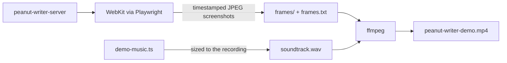

# Demo video

`mise run docs:demo` writes two files here, both gitignored:

| File                     | What                                                           |
| ------------------------ | -------------------------------------------------------------- |
| `peanut-writer-demo.mp4` | The demo: 1920×1080, 30 fps, H.264 + AAC, about 2¾ minutes     |
| `soundtrack.wav`         | Its music on its own: 48 kHz stereo, original and royalty-free |

Nothing in the video is edited by hand. Re-run the task whenever the UI changes; it takes about four minutes.

## The tour

A title card, then twelve numbered captions, then an end card:

1. **Start a document**: the start dialog, then Blank Document.
2. **Type on the left, see the page on the right**: a heading and a paragraph typed out, then a zoom into the preview.
3. **Format from the ribbon**: double-click a word, click Italic.
4. **Insert a table**: Insert → Table, the grid picker, the table dialog with a caption, which becomes Table 1.
5. **Cross-references keep up**: type `@`, pick the table from the suggestions.
6. **Write math in LaTeX**: Insert → Equation, with its live drawing and a reference name; zoom into the result.
7. **Add a title, author and abstract**: Edit header, then a zoom into the title block.
8. **Find any command in the palette**: Lorem Ipsum fills the document with figures and tables.
9. **Pick a look on the Design tab**: Academic, Report, Elegant, Journal, Peanut, back to Classic.
10. **It's plain Markdown underneath**: View → Markdown on and off.
11. **Jump around with the outline**: the editor and preview scroll together.
12. **Export to PDF, Word or a web page**: the Export menu and Sync files.

The end card has the Homebrew command and the docs URL.

## How it's made

### Recording: `docs/scripts/demo-video.ts`

- **The app** runs in Wails server mode (`bin/peanut-writer-server`, built by the task) with a fresh, empty home folder,
  started by `docs/scripts/app.ts`, which the screenshot script shares. It's driven in headless WebKit, the engine the
  macOS app renders with.
- **The window** is 1536×864 CSS pixels at 1.25× scale, which is exactly 1920×1080, close to the app's default window.
- **The overlay** is injected into the page, outside `#app`: a drawn cursor that glides to each target (CSS transitions)
  with a ripple on clicks, the caption pill, and the title and end cards. Zooms are a CSS transform on `#app`, so the
  overlay stays put while the app eases in and out. Because it's all in the page, it's in every frame; there is no
  compositing afterwards.
- **Human pacing**: text is typed a character at a time with random gaps, longer after spaces, punctuation and new
  lines. After each new line the editor scrolls so the cursor stays clear of the caption.
- **Frames** are screenshots taken in a loop alongside the actions (about 30 per second), each with the time it was
  taken. `frames.txt` gives each frame its real duration for ffmpeg's concat demuxer, so the video plays back in real
  time even though the frame rate wobbles. Playwright's own video recorder was too soft and its screencast only gives
  CSS-pixel frames, so screenshots it is.
- **Encoding**: `fps=30`, `libx264 -preset slow -crf 18 -tune animation`, AAC 192k, `+faststart`. The frames are deleted
  afterwards.

To change the tour, edit `perform` in `demo-video.ts`. The helpers on `Demo` are `caption`, `click`, `point`, `type`,
`zoom`, `card` and `wait`.

Limits of server mode: native menus and keyboard shortcuts handled by them (⌘/, ⇧⌘P) don't exist, so the tour uses
the ribbon and toolbar buttons instead. Export and Create New open native save dialogs, so the tour only shows the
Export menu and starts from Blank Document.

### Soundtrack: `docs/scripts/demo-music.ts`

`bun docs/scripts/demo-music.ts <seconds> <out.wav>` synthesizes the music from scratch, with no samples or
dependencies:

- **Style**: a mellow lo-fi groove in F, around 92 BPM, with swung eighths.
- **Chords**: Fmaj9 · Dm9 · B♭maj9 · C11, repeating every four bars.
- **Instruments**: an FM electric piano (sine carrier with a decaying 1:1 modulator and a high "tine" for the attack),
  a soft additive pad, a round sine bass with a passing note into each chord, a kick with a pitch sweep, a noise-burst
  brush snare and hats, and a marimba-like bell for the melody.
- **Arrangement**: piano and pad alone under the title card, then hats and bass, then the full kit. The bell melody
  plays in alternate phrases and answers itself on the way out. The video ends on a held Fmaj9.
- **Fitting the video**: the tempo is nudged so that whole four-bar phrases fill the recording, leaving five seconds for
  the last chord to ring.
- **Mix**: kick sidechain ducking on the piano and pad, a Freeverb reverb send, a gentle low-pass, tanh soft clip,
  fades, normalized to −1 dBFS peak. That comes out at about −15 LUFS, a normal level for web video.

Timing jitter uses a seeded random generator, so the same length always gives the same music.

## Tools

- Playwright (WebKit), from `docs/package.json`
- Bun, for both scripts
- ffmpeg (`brew install ffmpeg`)

The ArtCraft apps were looked at and not used. SoundCraft's control server has an undocumented protocol, and FilmCraft
and EffectCraft have no headless render. A script keeps the video reproducible from the repo alone.
