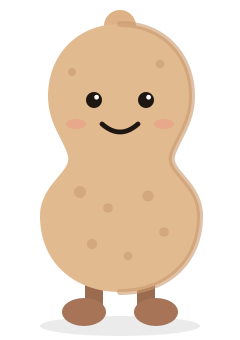
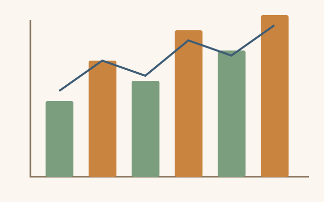

# Writing

Type on the left; the page on the right updates as you go. Use the **Home** tab for _emphasis_, headings and lists, or type Markdown directly — whatever you prefer. Everything you see here is plain text underneath: switch to **View → Markdown** (⌘/) to peek.

Paragraphs are separated by a blank line. Headings come in three sizes, and the ones you use become the document's outline.

## Formatting

- **Bold**, _italic_, ~~strikethrough~~ and `code` are on the Home tab.
- Links look like [the Peanut Writer guide](https://dustinmichels.github.io/peanut-writer/).
- Lists can be bulleted or numbered.
  - And nested, with Tab.

### Numbered lists

Numbered lists count for you, so you can reorder steps freely:

1. Write a first draft.
2. Add pictures, tables and equations.
3. Pick a template and export.

## Quotations

> A blank page is just a document that hasn't met its first peanut yet.

Quotations come from `>` at the start of a line, or the quote button on the Home tab.

# Figures

Drag an image onto the editor, paste one, or use **Insert → Picture**. Give it a caption and it becomes a numbered figure, like @fig:peanut. Hover a picture to move it left, center or right, drag its corner to resize it, or drag its grip (⠿) to move it somewhere else in the document.

{#fig:peanut width=28%}

Charts are just pictures too. @fig:harvest is set to 70% of the text width.

{#fig:harvest width=70%}

## Picture grids

Put two or more pictures in one paragraph and end it with a `Figure:` line to share one caption. @fig:shapes lays out two pictures side by side.

Figure: Two ways to draw a peanut, abstractly {#fig:shapes columns=2}

# Tables

Tables are made with **Insert → Table**. Click inside one and choose **Edit Table** to change it in a grid. @tbl:snacks is numbered on its own, separately from figures.

| Snack        | Crunch | Rating |
| :----------- | :----: | -----: |
| Peanuts      |  High  |     10 |
| Pretzels     | Medium |      7 |
| Marshmallows |  None  |      6 |

Table: Snacks, ranked very scientifically {#tbl:snacks}

Colons in the line under the header align a column: left, centered or right. Numbers usually read best on the right, as in @tbl:harvest.

| Quarter | Pounds | Growth | Notes                |
| :------ | -----: | -----: | :------------------- |
| Spring  |  1,250 |      — | Planting season      |
| Summer  |  2,300 |    84% | Plenty of sunshine   |
| Autumn  |  2,900 |    26% | The big harvest      |
| Winter  |    640 |   −78% | Roasting and resting |

Table: Peanut harvest, by quarter {#tbl:harvest}

# Math

Math is written in LaTeX between dollar signs. In a sentence, $x^2 + y^2 = r^2$ sits right in the line. Given $n$ peanuts weighing $w_1, \dots, w_n$, the average weight and its spread are @eq:mean:

$$
\bar{w} = \frac{1}{n} \sum_{i=1}^{n} w_i, \qquad \sigma^2 = \frac{1}{n} \sum_{i=1}^{n} (w_i - \bar{w})^2
$$ {#eq:mean}

Only named equations are numbered, and they can be referenced like figures and tables. Ordinary prices like $5 or $10 stay as text.

# Cross-references

**References → Cross-reference** inserts a reference to any figure, table or equation. Move @fig:peanut below @tbl:snacks and both numbers update, everywhere.[^1] A reference to a name that doesn't exist shows as **??** and is listed in the status bar.

[^1]: Footnotes come from **References → Footnote**.

# Make it yours

Pick a look on the **Design** tab, fill in the title, author and abstract under **Design → Properties**, then **Export** as PDF or Word. Each template sets its own fonts, spacing and headings, but your words stay the same.

> Tip: open the command palette and choose **Lorem Ipsum** to drop sample content into any document and see how a template handles it.
